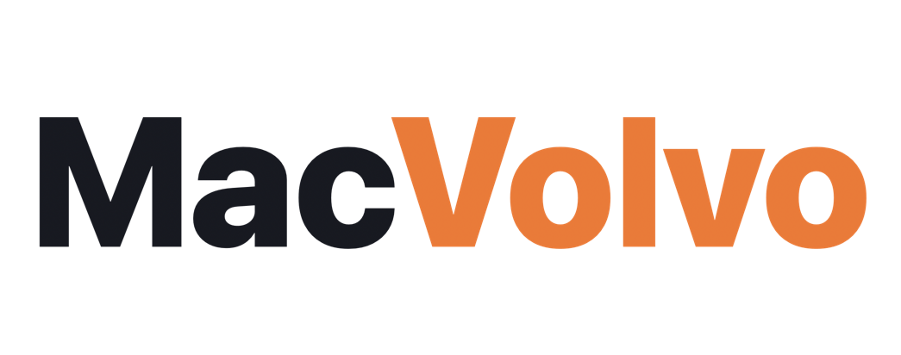

<h1 align="center">
  
</h1>

<h3 align="center">Counter-Strike 2 and Deadlock on your Mac.</h3>

It is the year 2026 CE, the Lord Gaben of Volvo hath not giveth Macintosh Deadlock, nor Counter Strike 2.

So I said fuck Gaben (Peace be upon him) and prayed to Mechanicus Claude Opus instead.

MacVolvo is a free, open-source app for playing Valve's Source 2 games on Apple Silicon, built on <a href="https://github.com/AsherJN/recall">Recall</a>.

---

> **Early release.** MacVolvo 0.1 runs Steam, Counter-Strike 2 and Deadlock on Recall's
> engine. Expect rough edges: see [Known issues](#known-issues).

## What it does

Valve dropped macOS support when Counter-Strike 2 replaced CS:GO, and Deadlock has never
had a Mac version. MacVolvo installs the Windows version of Steam into a private Wine
environment, and you play from there, with no CrossOver, Windows or Boot Camp needed.

It is a fork of [Recall](https://github.com/AsherJN/recall), Josh Nelson's app for playing
Overwatch on the Mac. Recall averaged about 70% more FPS than CrossOver on the same Mac, with
much better 1% lows and fewer stutters. That work carries over:

- **Wine**, built from CodeWeavers' CrossOver 26.3 sources, runs Steam and the games.
- **Rosetta** translates the games' Intel code to Apple Silicon.
- **DXMT** translates the games' Direct3D 11 graphics to Metal, with Recall's faster waits,
  frame pacing, third frame buffer and image compression kept on.
- **Raw mouse input** reads the mouse directly, up to 2,000 times a second, instead of
  waiting on macOS's pointer.
- **Game Mode**: each game starts as a Mac game, so macOS gives it priority.

See [how Recall runs faster](docs/HOW-IT-WORKS.md) for the engine details.

## Get started

1. **Download MacVolvo** from the [releases page](https://github.com/haeli05/MacVolvo/releases/latest),
   open the disk image and drag MacVolvo to Applications.
2. **Open MacVolvo** and follow the setup steps. It prepares everything and installs Steam.
3. **Open Steam, sign in,** and install Counter-Strike 2 or Deadlock from your Library.
4. **Pick a game in MacVolvo and press Play.**

| You need | |
|---|---|
| Mac | Apple Silicon (M1 or newer). Intel Macs aren't supported. |
| macOS | macOS Tahoe 26.5 or later |
| Memory | 16 GB recommended |
| Storage | About 70 GB free per game |
| Also | A Steam account, an internet connection, and Rosetta (MacVolvo checks for it) |

## About VAC

Counter-Strike 2 and Deadlock are protected by VAC, Valve's anti-cheat. MacVolvo runs the
games unmodified through Wine, the way Linux players have used Proton for years, but Valve
doesn't support playing them on macOS this way and we can't promise VAC won't object. Play on
an account you're prepared to take that risk with.

## Known issues

- **Steam's store and profile pages flicker while they load.** Once a page has loaded it
  draws normally. Steam's window uses a workaround for a Wine 11 bug (its browser draws black
  with the GPU off).
- **First matches stutter** while each game compiles its shaders for your Mac. It settles as
  you play the same maps again.
- **Audio can buzz or crackle.** In Audio MIDI Setup, try 96 kHz if your output supports it;
  this resolved the issue on the tested M2 Max. Other outputs may work better at 48 kHz.
  MacVolvo leaves the system audio format under your control.

## Building from source

See [build instructions](docs/BUILDING.md) and the [architecture notes](app/ARCHITECTURE.md).
MacVolvo uses Recall 1.3.0's runtime with a mouse timing fix; the MacVolvo-specific pieces are the Steam
worker (`scripts/portable_steam.h`), the Steam window fix (`scripts/webhelper_wrapper.c`) and
the app. [docs/HANDOFF.md](docs/HANDOFF.md) records how the Steam window fix was found.

## Credits and license

MacVolvo is a fork of [Recall](https://github.com/AsherJN/recall), created by Joshua Asher
Nelson. It uses Wine from CodeWeavers' published CrossOver sources, DXMT by Feifan He through
NerRobDog's fork, and Soju's runtime build recipe.

The original code is licensed under [Apache 2.0](LICENSE). Dependencies and patches keep
their own licenses; see the [third-party notices](THIRD_PARTY_NOTICES.md) and [NOTICE](NOTICE).

MacVolvo is an independent community project, not affiliated with or endorsed by Valve
Corporation, Volvo, Blizzard Entertainment, Apple or CodeWeavers. Counter-Strike, Deadlock,
Steam, Mac, CrossOver and other product names are trademarks of their respective owners.
